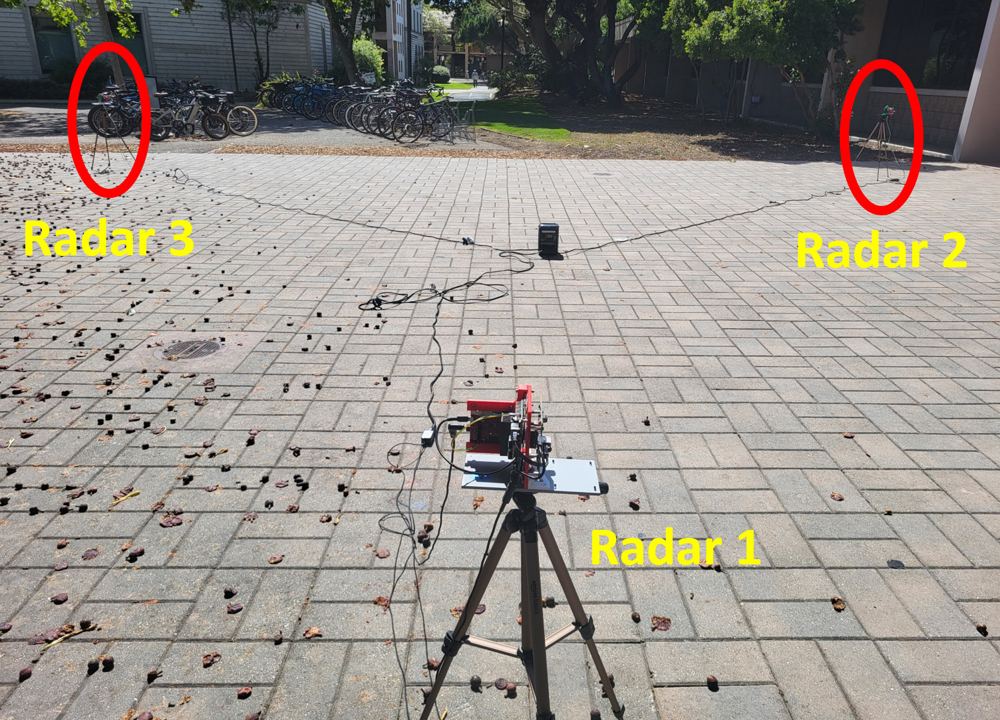
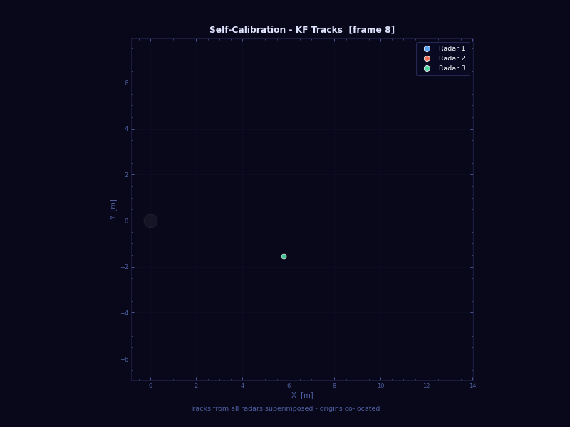

# NetRadar-FusionCenter

Fusion center (server) for **NetRadar**, a networked mmWave radar testbed. It is
the meeting point for all radar nodes: an MQTT broker, time-sync ticks that keep
the nodes' hardware triggers aligned, on-demand multi-node self-calibration, a
live bird's-eye dashboard, and a PostgreSQL store — all as Docker containers.

- **Radar nodes:** [NetRadar-Node](https://github.com/NetRadar-Testbed/NetRadar-Node)
- **Full documentation:** <https://netradar-testbed.github.io>

> NetRadar is built to be set up **from scratch on your own network**. Nothing in
> this repository points at any existing deployment: `setup.sh` generates fresh
> random passwords on your machine, and you create your own Tailscale network.

## Architecture

```
                    ┌──────────────┐
                    │   NanoMQ     │  MQTT broker (port 1883)
                    └───┬──────┬───┘
                        │      │
        ┌───────────────┤      ├───────────────┐
        ▼               ▼      ▼               ▼
 ┌────────────┐  ┌───────────┐  ┌───────────┐  ┌────────────┐
 │  timesync  │  │  bridge   │  │calibration│  │ dashboard  │
 │ periodic   │  │ MQTT → DB │  │ pairwise  │  │ web UI +   │
 │ capture/   │  │ persister │  │ RANSAC    │  │ API (5002) │
 │ start tick │  │           │  │ solver    │  │            │
 └────────────┘  └─────┬─────┘  └───────────┘  └────────────┘
                       │
                 ┌─────▼──────┐
                 │ PostgreSQL │  persistent store
                 └────────────┘
```

| Service | Role |
| :--- | :--- |
| **nanomq** | MQTT broker; one username/password per node |
| **postgres** | Stores frames, commands and calibration results |
| **bridge** | Subscribes to MQTT topics and inserts data into Postgres |
| **timesync** | Publishes `capture/start` ticks (~every 10 s) that align the nodes' triggers |
| **calibration** | On-demand pairwise self-calibration (RANSAC + network averaging) |
| **dashboard** | aiohttp + Socket.IO web UI: multi-node bird's-eye plot, node controls, calibration button |

## Quick start

Requirements: a Linux machine (x86-64 or ARM64) with
[Docker Engine + Compose](https://docs.docker.com/engine/install/) and
[Tailscale](https://tailscale.com/download).

```bash
# 1. Join your own Tailscale network (opens a login link)
sudo tailscale up

# 2. Get the code and generate this deployment's configuration
git clone https://github.com/NetRadar-Testbed/NetRadar-FusionCenter.git
cd NetRadar-FusionCenter
./setup.sh --nodes 3            # prints one block per node — keep them for the nodes

# 3. Start the stack
docker compose up -d --build

# 4. Make this machine the nodes' time authority
sudo ./time-sync/chrony-setup.sh master
```

Open the dashboard from any device on your tailnet: `http://<fusion-center-host>:5002`.

On each radar node, run `./configure.sh` and paste that node's block
(see NetRadar-Node). Show a block again with `./setup.sh --print-node node2`;
add a node later with `./setup.sh --add-node node4` followed by
`docker compose restart nanomq`.

```bash
docker compose logs -f        # follow all services
docker compose down           # stop (data stays in the pgdata volume)
```

## What `setup.sh` creates

All of these are git-ignored and readable only by you:

| File | Contents |
| :--- | :--- |
| `.env` | Address to listen on (your Tailscale IP), PostgreSQL password, the server's MQTT password, node list |
| `nanomq/auth/<user>` | One file per MQTT user (`server`, each node) holding its random password |
| `node-configs/<node>.env` | The block to paste into that node's `./configure.sh` |

Re-running `setup.sh` keeps existing passwords. `--force` regenerates all of
them (then reconfigure every node).

## Security model

- **Network:** the broker (1883) and dashboard (5002) listen only on this
  machine's Tailscale address; PostgreSQL only on `127.0.0.1`. Use a tailnet
  that only you (and your collaborators) control.
- **Dashboard has no login.** Anyone who can open it can start/stop nodes and
  run calibration — that is why it is reachable only from your tailnet.
- **Credentials:** every node has its own MQTT password; nothing has a default
  password, and Compose refuses to start until `setup.sh` has run.
- MQTT traffic is not TLS-encrypted by the broker; Tailscale encrypts it in
  transit between devices.

## Services in detail

### timesync

Periodically publishes `netradar/v1/group/<gid>/capture/start` with
`calibration: false`. Nodes use these ticks to start (or re-align) live hardware
frame capture — no calibration is required to begin.

### bridge

Persists four MQTT topic patterns into Postgres:

- `netradar/v1/group/+/capture/start` → `capture_commands`
- `netradar/v1/group/+/calibration/frame/+` → `calibration_frames`
- `netradar/v1/group/+/calibration/done/+` → `calibration_done`
- `netradar/v1/group/+/frames/+` → `live_frames`

Live frame messages carry the pre-cluster point cloud grouped by cluster: each
entry in `clusters[]` includes `detections`, the CFAR points DBSCAN grouped into
that cluster, as `[range_m, doppler_mps, angle_rad]`. Noise points are not sent.

### calibration

<p align="center">
  <br>
  <em>Self-calibration: pairs of radars that see the same people moving estimate their relative position and orientation (pairwise self-calibration), and the estimates are combined across the network (network averaging).</em>
</p>

Calibration is decoupled from the nodes: nodes always stream live frames, and
the calibration service never asks them to collect special data.

1. Pressing **Start Calibration** on the dashboard publishes
   `netradar/v1/server/start/request` with `captureConfig.calibration: true`.
2. The calibration service arms a collection window (nothing is sent to nodes).
3. It buffers the next `calibrationFrames` live frames per node (keyed by
   per-node arrival index — nodes share the same hardware pulse cadence).
4. When every streaming node has contributed enough frames (or the deadline
   expires) it runs RANSAC-robust closed-form pairwise calibration with
   network-level weighted averaging over direct and indirect paths.
5. The result is published to `netradar/v1/group/<gid>/calibration/result` and
   stored in Postgres.

<p align="center">
  <br>
  <em>Outdoor three-radar deployment (at UC Santa Barbara)…</em>
</p>

<p align="center">
  <br>
  <em>…and self-calibration on it: first each radar's tracks in its own coordinates, then the estimated radar positions and orientations (Radar 1 as reference) with the same people aligned across all three radars.</em>
</p>

The method is described in the papers listed under *Citing NetRadar*.

### dashboard

Real-time multi-node bird's-eye plot, per-node presence/status, node commands
(start/stop pipeline, start/reset radar) and the calibration trigger.

## MQTT topic reference

Topic prefix: `netradar/v1` (`NETRADAR_TOPIC_PREFIX`). The full protocol
(payloads, state machine) is in the documentation.

**Published by the fusion center**

| Topic | Publisher | Purpose |
| :--- | :--- | :--- |
| `netradar/v1/group/<gid>/capture/start` | timesync | Time-sync tick (live capture alignment) |
| `netradar/v1/server/start/request` | dashboard | Calibration trigger |
| `netradar/v1/server/start/result` | calibration | Calibration armed / rejected |
| `netradar/v1/group/<gid>/calibration/result` | calibration | Calibration result |
| `netradar/v1/server/status` | timesync, calibration | Server online/offline |
| `netradar/v1/group/<gid>/node/<nid>/command` | dashboard | Node commands |

**Expected from radar nodes**

| Topic | Purpose |
| :--- | :--- |
| `netradar/v1/presence/<nid>` | Node online/offline |
| `netradar/v1/group/<gid>/capture/state/<nid>` | Node state (idle / live / calib) |
| `netradar/v1/group/<gid>/capture/ack/<nid>` | ACK for capture/start |
| `netradar/v1/group/<gid>/node/<nid>/status` | Pipeline status |
| `netradar/v1/group/<gid>/frames/<nid>` | Live frame stream (also feeds calibration) |

## Database

PostgreSQL is initialised from `db/init.sql` with four tables:
`calibration_frames`, `calibration_done`, `live_frames` (per-frame clusters,
tracks and member detections) and `capture_commands`.

Query it on the fusion center (values from `.env`):

```bash
docker compose exec postgres psql -U netradar -d netradar
```

```sql
SELECT f.group_id, f.node_id, f.timestamp_ms,
       c->>'id' AS cluster_id, d->>0 AS range_m, d->>1 AS doppler_mps, d->>2 AS angle_rad
FROM live_frames f,
     jsonb_array_elements(f.clusters) c,
     jsonb_array_elements(c->'detections') d
LIMIT 20;
```

## Repository layout

```
.
├── setup.sh                # generates .env, broker users, node blocks
├── docker-compose.yml      # service orchestration
├── db/init.sql             # database schema
├── nanomq/nanomq.conf      # broker configuration (auth/ is generated)
├── bridge/                 # MQTT → Postgres bridge
├── timesync/               # periodic time-sync ticks
├── calibration/            # calibration orchestrator + closed-form math
├── dashboard/              # web UI
└── time-sync/              # chrony setup (identical to NetRadar-Node's)
```

## Citing NetRadar

If you use this software, or a testbed built with it, in published work, please
cite the papers below **and** state that your testbed was built using the
NetRadar open-source software (with the version). See `NOTICE` and
<https://netradar-testbed.github.io/citing/>.

```bibtex
@INPROCEEDINGS{11205142,
  author={Banik, Anirban and Giridhar, Lalitha and Kattekola, Aaditya Prakash and Pallaprolu, Anurag and Mostofi, Yasamin and Sabharwal, Ashutosh and Madhow, Upamanyu},
  booktitle={2025 IEEE Radar Conference (RadarConf25)},
  title={mmSnap: Bayesian One-Shot Fusion in a Self-Calibrated mmWave Radar Network},
  year={2025},
  pages={1116-1121},
  doi={10.1109/RadarConf2559087.2025.11205142}}

@INPROCEEDINGS{10942741,
  author={Banik, Anirban and Mostofi, Yasamin and Sabharwal, Ashutosh and Madhow, Upamanyu},
  booktitle={2024 58th Asilomar Conference on Signals, Systems, and Computers},
  title={Optimal Self-Calibration for Collaborative Sensing in mmWave Radar Networks},
  year={2024},
  pages={218-222},
  doi={10.1109/IEEECONF60004.2024.10942741}}
```

## Credits

Developed as part of the **Chirp Capstone Project 2025–2026, University of
California, Santa Barbara.**

- **Authors:** William Ni, Oviya Seeniraj, Andrey Otvagin, Vihan Jayaraman,
  Jason Wang, Anirban Banik
- **Mentor:** Anirban Banik
- **Advising professors:** Upamanyu Madhow, Yogananda Isukapalli

## License

Apache License 2.0 — see `LICENSE` and `NOTICE`.
